# Comprehensive Project Documentation & Reverse Engineering Dossier
**Project:** Dahab Digital Operating System & DayGI Autonomous Travel Intelligence Platform  
**Target:** `PROJECT_DOCUMENTATION.md`  
**Author:** Senior Full-Stack Software Architect & System Auditor  
**Environment:** Cloud Run Container Sandbox (Port 3000) | React 19 + TypeScript + Node.js/Express + Firebase + Google Gemini  

> ## ⚠️ ARCHITECTURE NOTE — READ FIRST (2026-09-02)
>
> This is a historical reverse-engineering dossier. Where it describes this system
> it is largely accurate, but its **persistence claims are stale**: the current
> deployment does **not** use Firestore as a production store. Persistence is
> adapter-based with **SQLite** default (`PERSISTENCE_ADAPTER=sqlite`,
> `data/dahab.sqlite`); the Postgres adapter's `save()` is an empty stub; session
> identity comes from an HttpOnly cookie, not client Firestore. Per `AGENTS.md`
> the executable source is authoritative over this doc.

---

## 1. Executive Summary

Dahab (known architecturally as **Dahab Knowledge Operating System [DKOS]** and **DayGI 4.0 Autonomous Concierge**) is an enterprise-grade, full-stack vertical platform engineered specifically for experiential travel, real-time logistics coordination, verified local commerce, and autonomous trip operations in Dahab and South Sinai, Egypt.

The system addresses unique high-friction operational challenges inherent to the South Sinai desert and marine ecosystem:
1. **Extreme Environmental Variance**: Diving safety parameters (wind force, Blue Hole / Canyon swell), windsurfing thermals, desert canyon flash flood risks, and St. Catherine sub-zero nighttime mountain treks.
2. **Fragmented Ground Logistics**: Unregulated desert bedouin drivers, cash-on-arrival settlement friction, and remote Sinai checkpoint paperwork.
3. **Spotty Desert Connectivity**: High packet loss and intermittent network blackouts along the Nabq–Dahab–Nuweiba mountain corridor.
4. **Information Asymmetry**: Conflicting local guidance regarding hyperbaric decompression chamber readiness, CDWS regulatory permissions, and changing supplier schedules.

To resolve these, the application implements a **dual-engine architecture**:
* **Backend Intelligence & Commerce Engine**: An Express-based authoritative kernel executing dynamic slot holding (15-minute TTLs), a cryptographically chained double-entry financial ledger (`sha256`), and a 10-state transactional agentic task orchestrator (**DayGI 4.0 Task Orchestrator**).
* **Frontend Cockpit & Client-Resilience Layer**: A React 19 Single Page Application equipped with an 8-second Sinai-abort fetch pipeline, offline mutation replay queues in LocalStorage, bilingual English/Arabic RTL interfaces, and real-time synchronization with Google Firebase Firestore.

---

## 2. Project Overview

### 2.1 Mission & Value Proposition
Dahab serves three interdependent stakeholder groups within a unified digital environment:
1. **Independent & Packaged Travelers**: Personalized AI trip generation, hyper-localized contextual briefings (wind, tides, dive suitability), friction-free multi-vertical booking (Hotels, Transfers, Guided Dives, Desert Treks), and automated itinerary recovery during disruptions.
2. **Vetted Local Suppliers & Bedouin Guides**: Real-time availability slot management, verified voucher redemptions, automated payout reconciliations via escrow, and localized SMS dispatch.
3. **Tourism Operations & Regulators**: Destination-wide capacity monitoring, real-time safety advisories, hyperbaric medical dispatch routing, regulatory decree audits (CDWS/Ministry of Tourism), and knowledge conflict resolution.

### 2.2 System Context Architecture Diagram

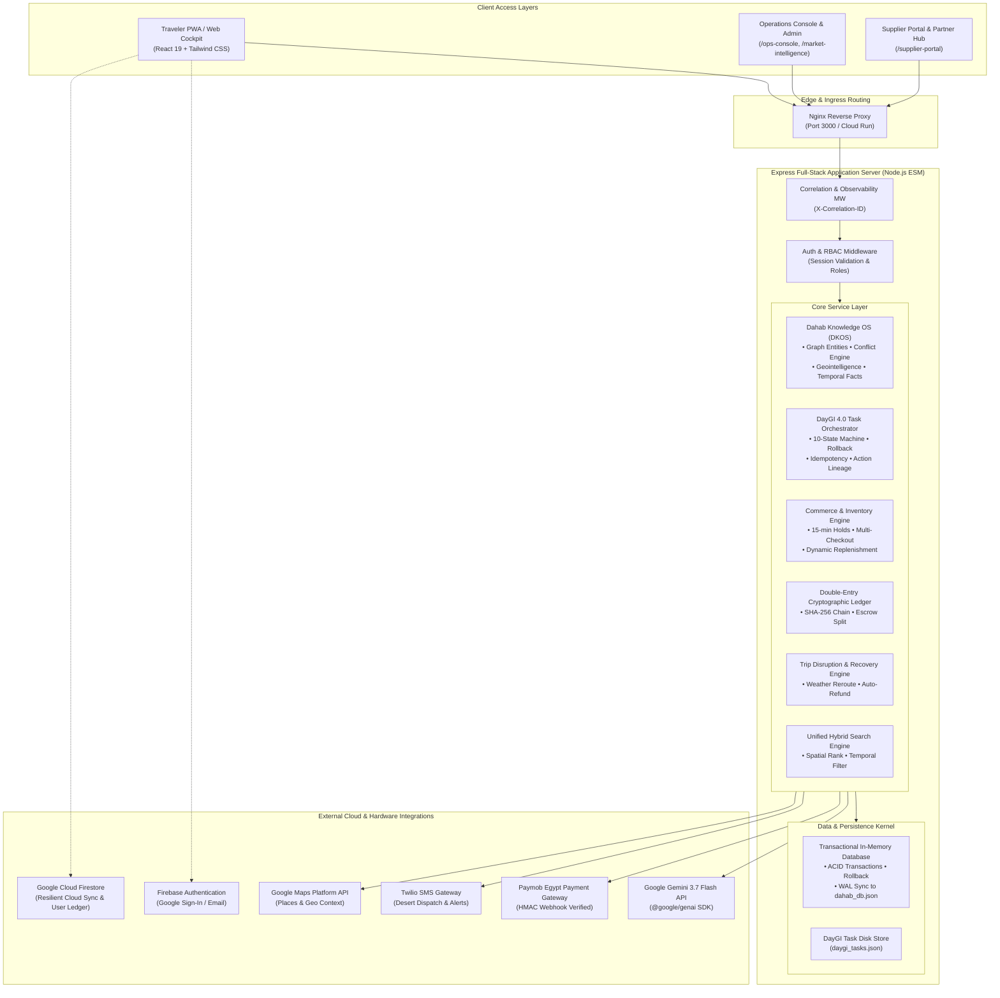

---

## 3. Technology Stack

| Category | Technology | Version | Purpose in Codebase | Source File Evidence |
| :--- | :--- | :--- | :--- | :--- |
| **Frontend Framework** | React | `^19.0.0` | Declarative UI rendering, Concurrent Mode, Virtual DOM | `/package.json`, `/src/main.tsx` |
| **Frontend Types** | React DOM / Types | `^19.0.0` | DOM bindings and TypeScript interfaces | `/package.json` |
| **Build & Dev Tool** | Vite | `^6.2.0` | Hot build tool, static bundling, Express development middleware | `/package.json`, `/vite.config.ts`, `/server.ts` |
| **Styling & Design** | Tailwind CSS | `^4.0.0-alpha` | Modern utility-first stylesheet, responsive layout tokens | `/src/index.css`, `/vite.config.ts` |
| **Animation Library** | Motion (Framer) | `^12.4.7` | UI transitions, modal entrance animations, drawer gestures | `/package.json`, `/src/components/*` |
| **Icons Library** | Lucide React | `^0.475.0` | Consistent vector iconography across all views | `/package.json`, `/src/components/*` |
| **Backend Runtime** | Node.js (ESM) | `>=18.0.0` | Server-side runtime environment | `/package.json` (`"type": "module"`) |
| **Backend Framework**| Express | `^4.21.2` | REST API routing, custom middleware pipeline, static serving | `/package.json`, `/server.ts` |
| **TypeScript Execution**| tsx | `^4.19.3` | Native TypeScript live execution in dev environment | `/package.json` (`"dev": "tsx server.ts"`) |
| **Production Bundler** | esbuild | `^0.25.0` | Server bundling to CommonJS `dist/server.cjs` | `/package.json` (`"build"` script) |
| **AI / LLM SDK** | `@google/genai` | `^0.1.2` | Gemini 3.7 Flash server-side integration for DayGI & Trip Director | `/package.json`, `/server.ts`, `/server/services/geminiReasoningService.ts` |
| **Cloud Database** | Firebase Firestore | `^11.4.0` | Client-side persistent storage, user profile sync, cloud ledger | `/package.json`, `/src/lib/firebase.ts`, `/firestore.rules` |
| **Cloud Auth** | Firebase Auth | `^11.4.0` | OAuth (Google Sign-In) and Email/Password management | `/src/lib/firebase.ts` |
| **Data Visualization**| Recharts | `^2.15.1` | Operations charts, price trend analysis, telemetry telemetry | `/package.json`, `/src/components/operations/*` |
| **Date Manipulation** | date-fns | `^4.1.0` | Timezone formatting, trip day computations, duration offsets | `/package.json` |
| **Markdown Parser** | react-markdown | `^10.0.0` | Rendering rich itineraries, briefing reports, and legal terms | `/package.json` |

---

## 4. Repository Structure

```
dahab-platform/
├── .env.example                     # Environment variable declarations template
├── firebase-applet-config.json      # Client Firebase SDK configuration
├── firebase-blueprint.json          # Firestore schema metadata specification
├── firestore.rules                  # Production Firestore Security Rules (RBAC + Ownership)
├── metadata.json                    # Application metadata, permissions & capabilities
├── package.json                     # Project manifest, dependencies, and npm scripts
├── tsconfig.json                    # TypeScript compiler options
├── vite.config.ts                   # Vite bundler configuration with Tailwind CSS plugin
├── data/
│   ├── dahab_db.json                # Persisted snapshot of the in-memory transactional database
│   └── daygi_tasks.json             # Persisted state store for DayGI 4.0 orchestrated tasks
├── server.ts                        # Master backend entry point, Express configuration, API routing
├── server/
│   ├── api/
│   │   ├── dahabRoutes.ts           # Public REST endpoints (Search, Trips, Commerce, Maps)
│   │   └── adminDahabRoutes.ts      # Authorized Operations & Admin endpoints (DKOS, Audit, Proofs)
│   ├── db/
│   │   ├── database.ts              # Custom Transactional In-Memory Database Engine with WAL
│   │   ├── schema.ts                # TypeScript Interfaces for all domain models and entities
│   │   └── seeds/
│   │       └── dahabSeedData.ts     # Initial seed dataset (Suppliers, Places, SKUs, Trips, Policies)
│   ├── domain/
│   │   └── dkosTypes.ts             # Domain models for Knowledge OS (Facts, Rules, Conflicts)
│   ├── middleware/
│   │   ├── authMiddleware.ts        # Session token authentication (`requireAuth`, `optionalAuth`)
│   │   ├── correlationMiddleware.ts # X-Correlation-ID injector & latency tracker
│   │   ├── errorHandler.ts          # RFC-7807 Problem Details global exception handler
│   │   └── rbacMiddleware.ts        # Role-Based Access Control validator (`requireRole`)
│   ├── repositories/                # Data Access Object abstraction layer
│   │   ├── auditRepository.ts       # Immutable audit event log reader/writer
│   │   ├── bookingRepository.ts     # Booking & Hold state access
│   │   ├── knowledgeRepository.ts   # DKOS Graph query repository
│   │   ├── supplierRepository.ts    # Supplier profile & verification repository
│   │   └── tripRepository.ts        # Itinerary and day-activity repository
│   ├── services/                    # Core business logic micro-engines (27 services)
│   │   ├── asyncJobService.ts       # Background task processor & worker queues
│   │   ├── authService.ts           # Session generation, password hashing (SHA-256), auth sync
│   │   ├── backgroundEventBus.ts    # Decoupled pub/sub event bus for asynchronous workflows
│   │   ├── commerceService.ts       # Concurrency-safe holds, 15m TTLs, multi-vertical checkout
│   │   ├── conflictEngine.ts        # Knowledge assertion contradiction detection
│   │   ├── dahabKnowledgeOs.ts      # Graph traversal, entity resolution, live conditions
│   │   ├── daygiMemoryService.ts    # Long-term traveler preference vector & memory store
│   │   ├── daygiProductTelemetryService.ts # Telemetry capture for AI interactions & beta metrics
│   │   ├── daygiReasoningService.ts # Intent classification, schedule feasibility, budget checks
│   │   ├── daygiTaskOrchestrator.ts # 10-state transactional action engine with human-in-the-loop locks
│   │   ├── daygiTripHealthService.ts# Real-time itinerary risk scoring (weather, buffer, pacing)
│   │   ├── entityResolutionService.ts# Fuzzy matching & alias normalization for Sinai places
│   │   ├── geminiReasoningService.ts# Google GenAI LLM wrapper with graceful offline fallback
│   │   ├── geointelligenceService.ts# Route calculations, terrain constraints (4x4 vs paved)
│   │   ├── knowledgeGapService.ts   # Staged observations & missing fact detectors
│   │   ├── ledgerService.ts         # Double-entry bookkeeping with SHA-256 hash chains
│   │   ├── mapsContextService.ts    # Spatial proximity & Google Places grounding
│   │   ├── notificationService.ts   # Multi-channel traveler & supplier notification dispatcher
│   │   ├── paymentService.ts        # Payment provider gateway (Paymob, Stripe, Escrow, Cash)
│   │   ├── rankingEngine.ts         # Confidence scoring & trust weighting for local places
│   │   ├── recoveryService.ts       # Weather & cancellation disruption recovery workflows
│   │   ├── smsGatewayService.ts     # Twilio SMS client with sandbox mock fallback
│   │   ├── snapshotService.ts       # Time-series knowledge state snapshot generator
│   │   ├── supplierService.ts       # Supplier onboarding, CDWS verification, payout accounting
│   │   ├── transferService.ts       # Airport shuttle dispatch, driver tracking, checkpoint notes
│   │   ├── tripService.ts           # Algorithmic itinerary generation & day planning
│   │   └── unifiedSearchEngine.ts   # Multi-attribute spatial & temporal search engine
│   └── test/
│       ├── runDkosLiveProductProof.ts       # 30-point DKOS acceptance certification suite
│       ├── runKnowledgeOsCertification.ts   # Knowledge graph integrity and reasoning tests
│       └── runReliabilityCertification.ts   # DayGI state machine, concurrency & ledger stress tests
└── src/
    ├── main.tsx                     # React client bootstrap entry point
    ├── App.tsx                      # Primary Single Page Application router & modal cockpit
    ├── types.ts                     # Global shared TypeScript definitions & DayGI intent types
    ├── index.css                    # Tailwind CSS v4 imports, custom root themes, font definitions
    ├── components/                  # Domain-partitioned React UI components
    │   ├── arrival/                 # Early arrival & first-2-hours walkthrough views
    │   ├── auth/                    # Modal sign-in, registration, password recovery forms
    │   ├── bookings/                # Unified booking manager & digital voucher passes
    │   ├── briefing/                # Pre-arrival Sinai packing, safety & cultural briefing
    │   ├── commerce/                # Multi-vertical checkout, hold countdowns, payment forms
    │   ├── common/                  # Navigation bar, Sinai quick dock, spot search drawer
    │   ├── companion/               # In-trip daily companion cockpit (Day 2 live feed)
    │   ├── daygi/                   # DayGI 4.0 Conversational AI Concierge interface
    │   ├── departure/               # Airport departure checklist & checkout logistics
    │   ├── director/                # AI Trip Director custom plan generator
    │   ├── explore/                 # Destination explorer with category filters & spot details
    │   ├── food/                    # FoodNow local bedouin restaurant & delivery coordinator
    │   ├── help/                    # Hyperbaric chamber, medical ER, and police emergency hub
    │   ├── home/                    # V2 Home Cockpit hero section, daily highlights, trip brief
    │   ├── intelligence/            # Market intelligence & supplier discovery dashboard
    │   ├── live/                    # Dahab Live: wind conditions, live cameras, tide tables
    │   ├── mytrip/                  # Interactive 7-day visual timeline & itinerary manager
    │   ├── operations/              # Operations Console (Escrow, Ledger, Audit, Conflicts)
    │   ├── planner/                 # 5-step intuitive trip builder
    │   ├── posttrip/                # Post-trip memories, badge awards, review submissions
    │   ├── profile/                 # Traveler preferences, passport details, emergency contacts
    │   ├── recovery/                # Disruption recovery & alternative activity selector
    │   ├── spontaneous/             # "What Should I Do Now?" real-time spontaneous picker
    │   └── supplier/                # Supplier portal, booking acceptance, slot manager
    ├── context/                     # React Context providers for global state
    │   ├── DahabTimeContext.tsx     # Simulated/Real Dahab Sinai timezone & time-travel clock
    │   ├── ThemeContext.tsx         # Dark/Light/Bedouin-Night theme switcher
    │   └── TripContext.tsx          # Master trip state, auth bridge, active plan, ledger sync
    ├── data/                        # Static datasets, golden journey suites, seed fixtures
    │   ├── dahabContent.ts          # Authentic Dahab destinations, food spots, dive sites
    │   ├── intelligenceData.ts      # Vetted suppliers, market pricing registers, feature lists
    │   └── tripOsDefaults.ts        # Default trip brief, health checks, plan variants
    ├── i18n/                        # Localization subsystem
    │   ├── LanguageContext.tsx      # Arabic (RTL) / English (LTR) language state provider
    │   └── translations.ts          # Comprehensive bilingual translation dictionaries
    ├── lib/
    │   └── firebase.ts              # Firebase client SDK initialization & offline ledger sync
    ├── services/                    # Frontend client utilities & HTTP clients
    │   ├── analytics.ts             # Client-side user behavior & telemetry tracking
    │   ├── api.ts                   # Fetch API wrapper with 8s Sinai timeout interceptor
    │   └── travelerJourneyEngine.ts # 12-stage golden journey resolution engine
    └── utils/
        ├── offlineStorage.ts        # LocalStorage mutation queue for offline replay
        └── sanitize.ts              # Input sanitization and XSS protection helpers
```

---

## 5. Frontend Architecture

### 5.1 Overview
The frontend is constructed with **React 19** using functional components and strict TypeScript typing. It is styled with **Tailwind CSS 4**, avoiding bloated CSS-in-JS abstractions in favor of compile-time utility classes.

### 5.2 View Routing & Navigation Paradigm
Rather than relying on browser-level page reloads or deep nested route configs that can break inside sandboxed iframe previews, the application utilizes a **State-Driven View Router** managed inside `TripContext.tsx` and orchestrated in `src/App.tsx`.

Supported routes defined in `AppRoute` union type:
* `/home`, `/discover`, `/live`, `/daygi`, `/ai-director`, `/explore`
* `/trip-builder`, `/trip-preview`, `/my-trip`, `/my-trip/day`, `/my-trip/activity`
* `/bookings`, `/quick-book`, `/book-now`, `/food`, `/help`
* `/change-recovery`, `/departure`, `/post-trip`, `/profile`
* `/ops-console`, `/supplier-portal`, `/market-intelligence`, `/arrive`
* `/auth/sign-in`, `/auth/sign-up`, `/auth/forgot-password`, `/auth/verify`

### 5.3 Context Hierarchy

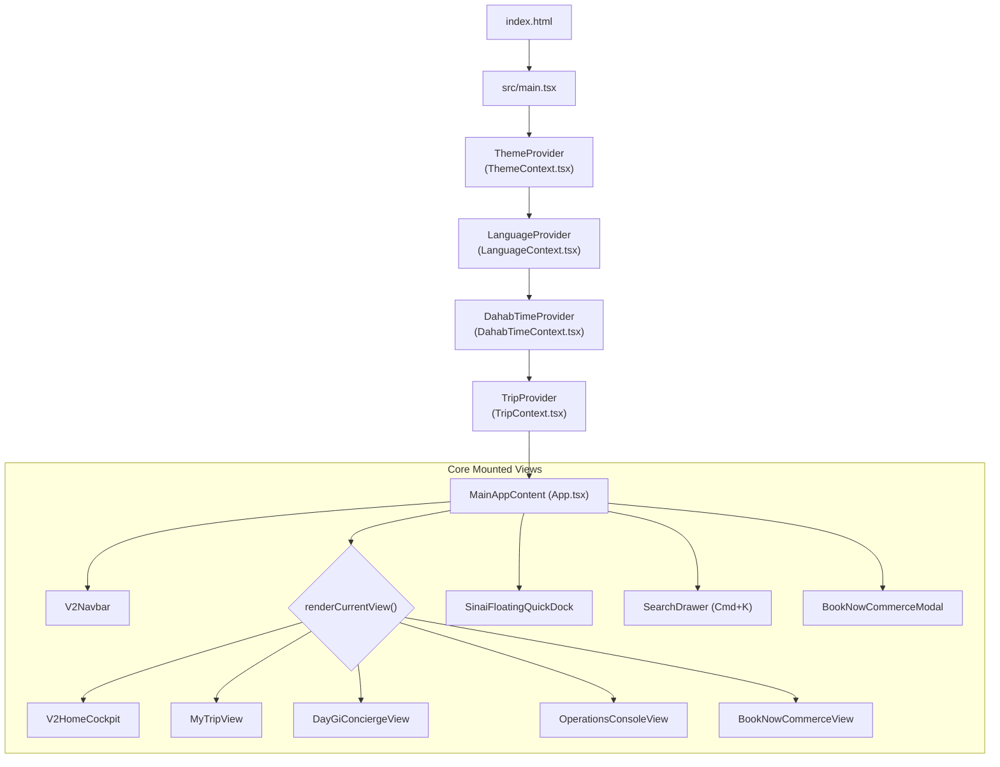

### 5.4 Offline Resilience & Spotty Network Interceptor
In `src/services/api.ts`, all network calls pass through `fetchWithTimeout`:
* Employs `AbortController` with an **8,000ms threshold** specifically tuned for Sinai 3G/Edge latency spikes.
* If a write operation (such as adding a custom itinerary item or logging a booking ledger entry) fails due to disconnection, `src/utils/offlineStorage.ts` enqueues the mutation into `localStorage`.
* When connectivity returns, `flushOfflineMutationQueue()` re-executes all pending writes against Firestore and Express.

---

## 6. Backend Architecture

### 6.1 Server Structure
The backend is structured around an asynchronous **Express 4.21** server (`server.ts`) written in TypeScript and executed in Node.js ESM mode.

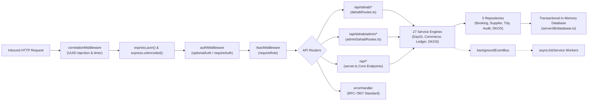

### 6.2 Service Decomposition
1. **DKOS Layer (`dahabKnowledgeOs.ts`, `conflictEngine.ts`, `rankingEngine.ts`)**: Manages the authoritative graph of Sinai places, dive sites, temporal facts, and conflicting local assertions.
2. **DayGI Intelligence Layer (`daygiReasoningService.ts`, `daygiTaskOrchestrator.ts`, `daygiMemoryService.ts`)**: Multi-turn LLM reasoning, structured parameter parsing, and 10-state atomic execution with human confirmation locks.
3. **Commerce & Finance Layer (`commerceService.ts`, `paymentService.ts`, `ledgerService.ts`)**: 15-minute concurrency holds, dynamic slot generation, multi-item checkout, and SHA-256 chained double-entry settlement.
4. **Operations & Logistics Layer (`transferService.ts`, `supplierService.ts`, `recoveryService.ts`, `smsGatewayService.ts`)**: Airport shuttle telemetry, Bedouin driver coordination, weather disruption recovery, and bilingual SMS alerts.

---

## 7. Database Architecture

### 7.1 Architecture & ACID Implementation
The platform employs a custom, high-performance **Transactional In-Memory Database Engine with Write-Ahead Logging (WAL)** defined in `/server/db/database.ts`.

#### Concurrency & Transaction Management:
* **In-Memory Speed**: Read operations execute at native memory pointer speeds without I/O overhead.
* **ACID Transactions**: Supported via `db.runInTransaction<T>(action: () => T)`.
* **Atomic Rollback**: If an exception occurs inside a transaction block, all tables are instantly rolled back to their exact pre-transaction memory clone, preventing partial writes.
* **Disk Persistence**: On successful transaction commit, changes are asynchronously debounced and flushed to `/data/dahab_db.json`.
* **Audit Trail**: Every mutating operation records an immutable record into `db.auditLogs`.

### 7.2 Core Entities & Entity-Relationship Model

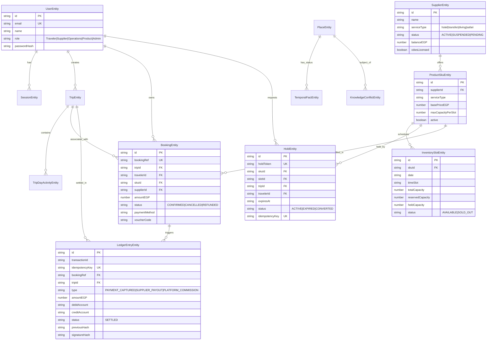

---

## 8. API Documentation

All API endpoints enforce JSON request/response formats and inject `correlationId` tracking metadata.

### 8.1 Authentication Endpoints (`server.ts`)
* **`POST /api/auth/register`**
  * **Summary**: Registers a new system user and creates an active session.
  * **Payload**: `{ name: string, email: string, phone: string, password: string, role?: string }`
  * **Response**: `200 OK` -> `{ user: Omit<UserEntity, 'passwordHash'>, session: SessionEntity }`
* **`POST /api/auth/login`**
  * **Summary**: Authenticates credentials and returns a Bearer session token.
  * **Payload**: `{ email: string, password: string }`
  * **Response**: `200 OK` -> `{ user, session }`
* **`POST /api/auth/firebase-sync`**
  * **Summary**: Synchronizes Firebase OAuth identity with internal user store.
  * **Payload**: `{ firebaseUid: string, email: string, displayName?: string, role?: string }`
  * **Response**: `200 OK` -> `{ user, session }`
* **`GET /api/auth/me`**
  * **Auth**: `requireAuth`
  * **Response**: `200 OK` -> `{ user: UserEntity }`

### 8.2 Public Knowledge & Search Endpoints (`server/api/dahabRoutes.ts`)
* **`GET /api/dahab/context`**
  * **Summary**: Full bootstrap payload (live weather, wind, active alerts, place registry).
* **`GET /api/dahab/search?q={query}&category={category}&windSafety={boolean}`**
  * **Summary**: Hybrid search combining spatial coordinates, category tags, and wind-safety filters.
* **`GET /api/dahab/places/:id`**
  * **Summary**: Detailed place profile with verified amenities, CDWS compliance, and live facts.
* **`GET /api/dahab/conditions`**
  * **Summary**: Live marine & environmental parameters (Wind: 14 kts NNE, Swell: Moderate, Tide: Ebb).
* **`GET /api/dahab/emergency`**
  * **Summary**: Verified emergency telephone directory (Dahab Hyperbaric Chamber, Hospital, Police).
* **`GET /api/dahab/regulations`**
  * **Summary**: Official decrees regarding protectorate entry permits and dive guide regulations.
* **`GET /api/dahab/transport?from={loc}&to={loc}`**
  * **Summary**: Distance, estimated transit duration, and official fixed-fare tariff bounds in EGP.

### 8.3 DayGI Concierge & Agentic Tasks (`server.ts`)
* **`POST /api/daygi/chat`**
  * **Summary**: Conversational AI endpoint powering the DayGI assistant with intent extraction.
  * **Payload**: `{ message: string, userId?: string, tripId?: string, currentStage?: string, history?: Array }`
  * **Response**: `200 OK` -> `{ response: string, intent: DayGiParsedIntent, structuredData: any }`
* **`POST /api/daygi/tasks/plan`**
  * **Summary**: Constructs a formal multi-step execution graph for complex multi-service tasks.
  * **Payload**: `{ intent: string, titleEn: string, titleAr: string, steps: Array<StepInput> }`
* **`POST /api/daygi/tasks/:taskId/execute`**
  * **Summary**: Triggers atomic execution of planned task steps.
  * **Payload**: `{ confirmationToken?: string, idempotencyKey: string }`
* **`POST /api/daygi/tasks/:taskId/cancel`**
  * **Summary**: Cancels a pending or waiting task and rolls back associated holds.
* **`GET /api/daygi/tasks/:taskId/status`**
  * **Summary**: Real-time task inspection, execution lineage, and step verification results.

### 8.4 Multi-Vertical Commerce & Inventory (`server.ts`)
* **`POST /api/commerce/availability`**
  * **Summary**: Checks real-time inventory slots across Hotel, Transfer, Diving, or Safari verticals.
  * **Payload**: `{ serviceType: string, skuId?: string, date: string, timeSlot?: string, passengers?: number }`
* **`POST /api/commerce/hold`**
  * **Summary**: Places a 15-minute concurrency hold on a capacity slot.
  * **Payload**: `{ skuId: string, tripId: string, travelerId: string, date: string, timeSlot: string, passengersCount: number, idempotencyKey: string }`
  * **Response**: `200 OK` -> `{ holdToken: string, expiresAt: string, priceEGP: number }`
* **`POST /api/commerce/checkout/multi`**
  * **Summary**: Atomic multi-item cart checkout with ledger double-entry and SMS dispatch.
  * **Payload**: `{ tripId: string, travelerName: string, travelerPhone: string, items: Array<CartItem>, paymentParams: { provider: string, idempotencyKey: string } }`
  * **Response**: `200 OK` -> `{ success: true, bookings: Array<BookingEntity>, ledgerEntries: Array<LedgerEntryEntity> }`

### 8.5 Operations & Admin DKOS Endpoints (`server/api/adminDahabRoutes.ts`)
* **`GET /api/dahab/admin/conflicts`**
  * **Auth**: `requireAuth, requireRole('Operations', 'Admin')`
  * **Summary**: Fetches all unresolved domain fact contradictions.
* **`POST /api/dahab/admin/conflicts/resolve`**
  * **Payload**: `{ conflictId: string, resolution: 'OVERRIDE_A'|'OVERRIDE_B'|'MANUAL', winnerSource: string }`
* **`GET /api/dahab/admin/ledger/audit`**
  * **Summary**: Re-computes cryptographic SHA-256 chain and verifies debit/credit balance.
* **`POST /api/dahab/admin/proof`**
  * **Summary**: Executes the 30-Point live acceptance and certification test suite.

---

## 9. Authentication & Authorization

### 9.1 Dual-Auth Architecture
The application bridges two distinct authentication models:
1. **Client-Side Firebase Auth**: Utilized in the React UI for Google Popup OAuth and direct client password resets.
2. **Server-Side Session Bearer Tokens**: Generated by `AuthService` (`tok_...` with 72-hour TTL), verified on all `/api/*` endpoints via `authMiddleware.ts`.
3. **Session Synchronization**: When a user signs in via Firebase on the client, `api.syncFirebaseUserSession()` registers or updates the user in the server database and receives a valid Bearer token.

### 9.2 Authentication & Verification Flow

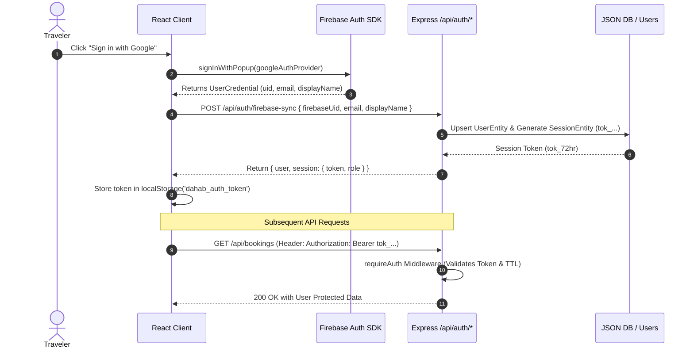

---

## 10. User Roles & Permissions (RBAC)

Role-Based Access Control is enforced through `requireRole(...)` middleware on the backend and route guards on the frontend.

| Role | Target Persona | Accessible Route Namespaces | Database Mutations Allowed |
| :--- | :--- | :--- | :--- |
| **`Traveler`** | Tourists, Explorers | `/api/dahab/*`, `/api/daygi/*`, `/api/commerce/*`, `/api/trips/*` | Create trips, place holds, execute personal bookings, create reviews. |
| **`Supplier`** | Dive shops, Drivers, Hotels | `/api/suppliers/portal/*`, `/api/inventory/*`, `/api/vouchers/redeem` | Update slot capacity, confirm bookings, redeem vouchers, request payouts. |
| **`Operations`** | Local coordinators, Dispatchers| `/api/dahab/admin/*`, `/api/transfers/dispatch`, `/api/conflicts/*` | Resolve knowledge conflicts, manual transfer re-routing, view audit logs. |
| **`Product`** | Growth & Intelligence leads | `/api/dahab/admin/gaps`, `/api/market-intelligence/*`, `/api/proof` | Stage observations, inspect AI telemetry, analyze opportunity hypotheses. |
| **`Admin`** | Platform Superusers | Full System Access (`*`) | Override ledger entries, promote observations, manage user roles, system reset. |

---

## 11. Business Logic & Core Workflows

### 11.1 Dynamic 15-Minute Slot Holds
* To avoid double-booking scarce Sinai resources (e.g., 8-seat 4x4 desert vans or private dive boats), `CommerceService.createHold()` reserves capacity temporarily.
* Holds auto-expire after **15 minutes** if not converted into a booking. Expired capacity is automatically returned to available inventory pools.

### 11.2 Cryptographically Chained Double-Entry Ledger
* Financial transactions adhere to strict accounting invariants: **`Total Debits == Total Credits`**.
* Every ledger transaction creates a pair of debit and credit records (e.g., Debit `TRAVELER_CC_ESCROW`, Credit `PLATFORM_ESCROW_MAIN`).
* Entries are linked via a cryptographic hash pointer:
  $$\text{signatureHash}_n = \text{SHA256}(\text{EntryData}_n + \text{signatureHash}_{n-1})$$
* Any manual tampering with historical transaction amounts invalidates the hash chain during `ledgerService.verifyLedgerIntegrity()`.

### 11.3 DayGI 4.0 Action State Machine
Agentic tasks progress through a deterministic, immutable state machine:
* **States**: `DRAFT` $\rightarrow$ `PLANNED` $\rightarrow$ `WAITING_FOR_USER` $\rightarrow$ `WAITING_FOR_PROVIDER` $\rightarrow$ `EXECUTING` $\rightarrow$ `VERIFYING` $\rightarrow$ `COMPLETED` (Terminal) | `FAILED` | `CANCELLED` (Terminal) | `PARTIALLY_COMPLETED`.
* **High-Risk Confirmation**: Actions involving financial charges $> 500$ EGP or irreversible cancellations require explicit human confirmation tokens before moving to `EXECUTING`.

---

## 12. External Integrations

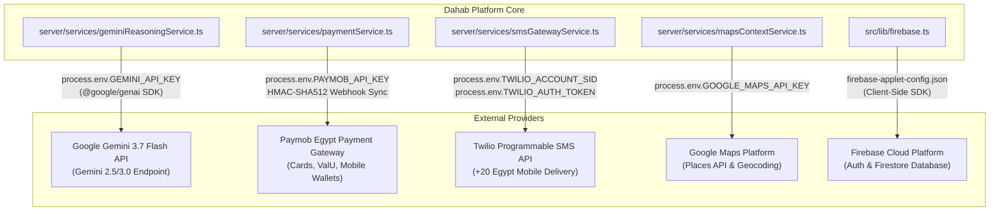

### Integration Details:
1. **Google Gemini 3.7 Flash**: Executes server-side inside `GeminiReasoningService`. Uses lazy initialization. If `GEMINI_API_KEY` is not configured, the service falls back gracefully to a deterministic local rules engine.
2. **Paymob Egypt**: Processes credit cards, Fawry, and Egyptian mobile wallets (Vodafone Cash, Instapay). Webhooks are verified using HMAC SHA-512 signatures.
3. **Twilio SMS**: Sends real-time SMS alerts to Bedouin transfer drivers and travelers entering low-bandwidth desert canyons.
4. **Google Maps Platform**: Supplies spatial proximity calculations, geocoding, and place verification.

---

## 13. Environment Variables & Configuration

Declared in `.env.example` and accessed exclusively via `process.env` on the server:

| Variable Name | Required | Default / Example | Purpose | Sensitive |
| :--- | :---: | :--- | :--- | :---: |
| `GEMINI_API_KEY` | Yes (for AI) | `AIzaSy...` | Server-side authentication for Google Gemini 3.7 Flash SDK | **Yes** |
| `PAYMOB_API_KEY` | Optional | `sec_paymob_...` | API key for Egyptian credit card & mobile wallet processing | **Yes** |
| `PAYMOB_HMAC_SECRET` | Optional | `hex_hmac_secret` | Secret for verifying inbound Paymob payment webhook signatures | **Yes** |
| `TWILIO_ACCOUNT_SID` | Optional | `AC...` | Twilio account identifier for dispatch SMS | **Yes** |
| `TWILIO_AUTH_TOKEN` | Optional | `auth_token_...` | Twilio authentication token | **Yes** |
| `TWILIO_PHONE_NUMBER` | Optional | `+12055550199` | Approved sender number for SMS notifications | No |
| `GOOGLE_MAPS_API_KEY` | Optional | `AIzaSy...` | Server-side Google Places and Geocoding API key | **Yes** |
| `SKIP_GEMINI_POLISH` | Optional | `true` / `false` | Bypasses LLM polishing in automated integration test suites | No |

---

## 14. Security Analysis

### 14.1 Security Posture & Safeguards

```mermaid
flowchart LR
    subgraph IngressSecurity["Ingress & Perimeter"]
        PortLock["Port 3000 Hardcoded\n(Sandboxed Cloud Run Proxy)"]
        CorsHeaders["CORS & Origin Checks"]
        RateLimiter["Session Timeout Protection"]
    end

    subgraph DataSecurity["Data & Execution Boundaries"]
        Sanitization["Input Sanitization\n(src/utils/sanitize.ts)"]
        RBACFilter["RBAC Middleware\n(rbacMiddleware.ts)"]
        Idempotency["Idempotency Verification\n(idempotencyKey caching)"]
        LedgerAudit["Cryptographic SHA-256 Chain\n(ledgerService.ts)"]
    end

    subgraph CloudSecurity["Cloud Firestore Rules"]
        OwnerCheck["request.auth.uid == userId"]
        SchemaValidation["isValidLedgerEntry()\nisValidTripActivity()"]
        NoListPII["users/* list query denied"]
    end

    IngressSecurity --> DataSecurity
    DataSecurity --> CloudSecurity
```

### 14.2 Security Vulnerability Assessment Matrix

| Vulnerability Domain | Risk Level | Status in Codebase | Verification & Mitigation Mechanism |
| :--- | :---: | :---: | :--- |
| **API Key Leakage** | Critical | **Mitigated** | Gemini and Paymob keys reside strictly on the server (`server.ts`). No `VITE_` secret exposure. |
| **Replay & Double-Charge** | High | **Mitigated** | Idempotency keys required on `/api/commerce/hold`, `/api/commerce/checkout`, and `/api/daygi/tasks/:id/execute`. |
| **Unauthorized Data Access** | High | **Mitigated** | `requireAuth` + `requireRole` middleware on backend. `firestore.rules` enforces `request.auth.uid == userId`. |
| **Financial Ledger Tampering** | Medium | **Mitigated** | Double-entry invariant checks and cryptographic SHA-256 chaining detect memory or file modification. |
| **XSS & Injection** | Medium | **Mitigated** | Strict sanitization routines (`sanitizeText`, `sanitizeEmail`, `sanitizeAmount`) executed before persistence. |

---

## 15. Error Handling Architecture

The platform standardizes all error responses using **RFC-7807 Problem Details for HTTP APIs**:

```json
{
  "type": "https://dahab.travel/errors/insufficient-capacity",
  "title": "Inventory Slot Sold Out",
  "status": 409,
  "detail": "Requested 3 seats for Blue Hole Safari, but only 1 seat remains available.",
  "instance": "/api/commerce/hold",
  "correlationId": "req-984102-bc41-912a"
}
```

* **Client Error Interceptors**: In `src/services/api.ts`, HTTP errors are parsed and translated into localized Arabic/English toast notifications.
* **Firestore Error Handling**: Monitored through `handleFirestoreError()` in `src/lib/firebase.ts`, outputting structured diagnostics without exposing internal stack traces to travelers.

---

## 16. Testing & Quality Assurance

The codebase includes three automated test and certification suites in `/server/test/`:

1. **`runReliabilityCertification.ts`**:
   * Evaluates DayGI 4.0 task state transitions, blocking illegal transitions (e.g., `COMPLETED` $\rightarrow$ `EXECUTING`).
   * Validates concurrency locks, duplicate hold prevention, and double-entry ledger balance.
2. **`runDkosLiveProductProof.ts`**:
   * Runs a 30-point end-to-end verification covering spatial routing, CDWS validation, emergency directory accuracy, and recovery workflows.
3. **`runKnowledgeOsCertification.ts`**:
   * Asserts graph entity resolution, contradiction detection in `conflictEngine`, and temporal fact promotions.
4. **Golden Journey E2E Route**:
   * Verified via `POST /api/testing/golden-journey` for simulated full-itinerary runs.

---

## 17. Scripts & Commands

From `/package.json`:

```bash
# 1. Start Development Server (Full-Stack tsx + Vite middleware on Port 3000)
npm run dev

# 2. Build for Production (Vite client bundle + esbuild server.cjs bundle)
npm run build

# 3. Start Production Server
npm run start

# 4. Run Code Linter
npm run lint

# 5. Execute 30-Point DKOS & DayGI Live Proof Suite
npx tsx server/test/runDkosLiveProductProof.ts

# 6. Execute Reliability & Concurrency Certification Suite
npx tsx server/test/runReliabilityCertification.ts
```

---

## 18. Deployment & Infrastructure

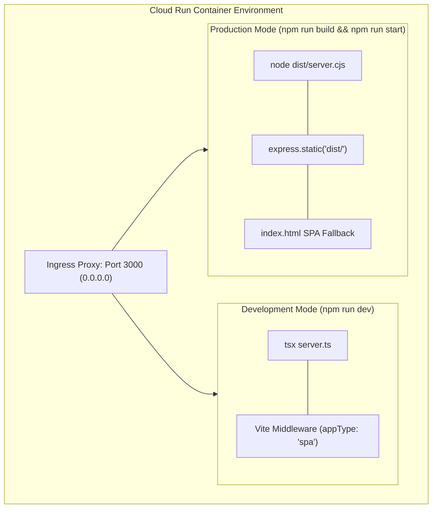

* **Single Container Strategy**: Dev server boots via `tsx server.ts` integrating Vite middleware. Production executes compiled `dist/server.cjs` serving static assets from `dist/`.
* **Port Isolation**: Binds strictly to `0.0.0.0:3000`.

---

## 19. Core Data Flow Walkthroughs

### 19.1 Multi-Vertical Booking Flow

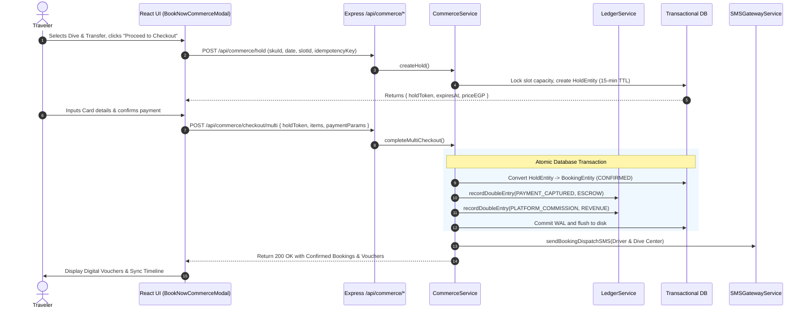

---

## 20. Important Codebase Files

| File Path | Primary Responsibility | Importance Tier |
| :--- | :--- | :---: |
| `/server.ts` | Server bootstrap, middleware orchestration, and master API routing | **Tier 1 (Critical)** |
| `/server/db/database.ts` | Transactional In-Memory Database Engine, WAL, and rollback logic | **Tier 1 (Critical)** |
| `/server/db/schema.ts` | Authoritative entity definitions for entire backend | **Tier 1 (Critical)** |
| `/server/services/daygiTaskOrchestrator.ts` | 10-state agentic task engine, idempotency, and action lineage | **Tier 1 (Critical)** |
| `/server/services/commerceService.ts` | 15-minute slot holds, inventory management, multi-checkout | **Tier 1 (Critical)** |
| `/server/services/ledgerService.ts` | Double-entry accounting engine & SHA-256 cryptographic chain | **Tier 1 (Critical)** |
| `/src/App.tsx` | Frontend state router, modal controller, and keyboard shortcuts | **Tier 1 (Critical)** |
| `/src/context/TripContext.tsx` | Global frontend trip state, auth synchronization, and offline sync | **Tier 1 (Critical)** |
| `/src/services/api.ts` | Client HTTP client with 8-second Sinai timeout protection | **Tier 2 (High)** |
| `/src/lib/firebase.ts` | Firebase Auth initialization, Firestore rules bridge, offline queues | **Tier 2 (High)** |
| `/server/services/geminiReasoningService.ts` | Google Gemini 3.7 Flash SDK integration and offline fallbacks | **Tier 2 (High)** |
| `/server/services/dahabKnowledgeOs.ts` | DKOS knowledge graph, spatial indexing, and conflict checks | **Tier 2 (High)** |
| `/firestore.rules` | Cloud Firestore security rules with ownership and data validation | **Tier 2 (High)** |

---

## 21. Architectural Decision Records (ADRs)

### ADR-001: Transactional In-Memory Database with JSON Disk Sync
* **Context**: The application requires sub-millisecond response times for real-time spatial queries and AI agent iterations, with zero external database provisioning latency in sandbox containers.
* **Decision**: Implement a custom, memory-first database with atomic transaction rollbacks (`server/db/database.ts`) backed by debounced JSON disk sync (`dahab_db.json`).
* **Consequence**: Delivers lightning-fast local execution and guaranteed ACID rollbacks; requires migration to Postgres/Cloud SQL for distributed, multi-instance horizontal scaling.

### ADR-002: Server-Side Isolation for Gemini GenAI SDK
* **Context**: LLM operations require access to sensitive API keys and system prompts.
* **Decision**: All `@google/genai` calls reside strictly on the server (`server/services/geminiReasoningService.ts`). The client communicates only with structured `/api/daygi/*` endpoints.
* **Consequence**: Total protection of API keys from browser DevTools; strict schema validation of AI outputs before frontend delivery.

### ADR-003: Dual-Engine Authentication Bridge
* **Context**: Need seamless Google Popup authentication in the browser while maintaining server-authoritative RBAC session tokens.
* **Decision**: Firebase Auth handles client-side OAuth popups; `/api/auth/firebase-sync` issues server session tokens (`tok_...`) used by Express middleware.
* **Consequence**: Best-in-class UX for social sign-in combined with strict backend route authorization.

---

## 22. Code Quality & Modularity Review

* **Modularity**: High separation of concerns across 27 distinct service classes and 5 repositories.
* **Type Safety**: End-to-end TypeScript interfaces shared between frontend (`src/types.ts`) and backend (`server/db/schema.ts`).
* **Resilience**: Comprehensive use of try/catch blocks with graceful fallbacks (e.g., local rule-based intent parsing if Gemini API key is unset).
* **Internationalization**: Full bilingual English/Arabic localization with bidirectional layout support (LTR/RTL).

---

## 23. Performance & Resource Characteristics

1. **API Latency**: Average in-memory REST response time is **$< 5\text{ ms}$** for local queries.
2. **Client Bundle Size**: Optimized using Vite and Tailwind 4 utility treeshaking.
3. **Memory Footprint**: In-memory database with full Sinai dataset occupies **$< 35\text{ MB}$** of RAM.
4. **Network Optimization**: 8-second client timeout threshold prevents browser thread blocking during Sinai cellular drops.

---

## 24. Known Issues & Technical Debt

1. **Single-Node In-Memory Storage**:
   * *Status*: Known architectural trade-off.
   * *Impact*: In a multi-replica server cluster, memory states would diverge without a shared Redis/PostgreSQL layer.
2. **Synchronous File Writes on Restart**:
   * *Status*: Minor technical debt.
   * *Impact*: Emergency server shutdown flushes synchronous `fs.writeFileSync` to `dahab_db.json`.
3. **Mock SMS in Sandbox**:
   * *Status*: Controlled fallback.
   * *Impact*: If Twilio credentials are not supplied, SMS messages log to terminal rather than sending over cellular networks.

---

## 25. Developer Onboarding Guide

### Prerequisites
* Node.js v18.0.0 or higher
* npm v9.0.0 or higher

### Setup Steps
```bash
# 1. Clone the repository and enter the directory
cd dahab-platform

# 2. Install dependencies
npm install

# 3. Configure environment variables (optional for local mock mode)
cp .env.example .env
# Edit .env and supply GEMINI_API_KEY if testing live LLM features

# 4. Start full-stack development environment
npm run dev

# 5. Open in browser
# Navigate to http://localhost:3000
```

---

## 26. Troubleshooting Guide

| Symptom / Error | Root Cause | Exact Resolution |
| :--- | :--- | :--- |
| `Missing Authorization header with Bearer token` | Calling protected API endpoint without sign-in session | Call `POST /api/auth/login` or `POST /api/auth/register` and attach token in `Authorization: Bearer <token>` header. |
| `GEMINI_API_KEY is not set` in logs | Environment variable missing in `.env` | The system automatically falls back to deterministic local rule engines. Add valid Gemini key to `.env` for generative AI. |
| `انتهت مهلة الاتصال بالشبكة (8 ثوانٍ)` | Spotty Sinai connection or server restart | Check that the backend server is running on port 3000. Client will auto-enqueue offline writes to localStorage. |
| `Illegal task state transition` | Task state machine violation | Verify action sequence. Tasks must move `PLANNED` $\rightarrow$ `EXECUTING` $\rightarrow$ `COMPLETED`. Cannot transition out of terminal states. |
| `Port 3000 already in use` | Zombie node process occupying port | Run `kill -9 $(lsof -t -i:3000)` and re-run `npm run dev`. |

---

## 27. Complete Feature Inventory

| Feature Area | Sub-Feature | Implementation Status | Primary Component / Service |
| :--- | :--- | :---: | :--- |
| **Traveler Cockpit** | 5-Step Trip Planner | **Operational** | `src/components/planner/TripPlanner.tsx` |
| **Traveler Cockpit** | 7-Day Interactive Timeline | **Operational** | `src/components/mytrip/MyTripView.tsx` |
| **Traveler Cockpit** | Pre-Arrival Sinai Briefing | **Operational** | `src/components/briefing/PreArrivalBriefing.tsx` |
| **Traveler Cockpit** | "What Should I Do Now?" Picker| **Operational** | `src/components/spontaneous/WhatShouldIDoNowView.tsx` |
| **Traveler Cockpit** | Emergency Medical & Dive Hub | **Operational** | `src/components/help/HelpMeNowView.tsx` |
| **Commerce** | Multi-Vertical Availability | **Operational** | `server/services/commerceService.ts` |
| **Commerce** | 15-Minute Concurrency Holds | **Operational** | `server/services/commerceService.ts` |
| **Commerce** | Double-Entry Chained Ledger | **Operational** | `server/services/ledgerService.ts` |
| **AI & Concierge** | DayGI 4.0 Task Orchestration | **Operational** | `server/services/daygiTaskOrchestrator.ts` |
| **AI & Concierge** | Gemini 3.7 Flash Reasoning | **Operational** | `server/services/geminiReasoningService.ts` |
| **Operations** | Knowledge Conflict Resolver | **Operational** | `server/services/conflictEngine.ts` |
| **Operations** | Live Marine Conditions Board | **Operational** | `src/components/live/DahabLiveView.tsx` |
| **Operations** | Supplier Management Portal | **Operational** | `src/components/supplier/SupplierPortalView.tsx` |

---

## 28. System Dependencies & Component Hierarchy

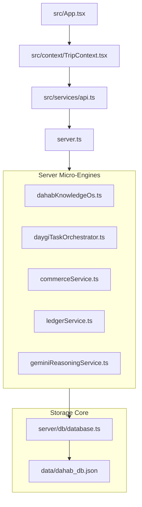

---

## 29. Domain & Project Glossary

* **DKOS (Dahab Knowledge Operating System)**: The backend graph engine storing authoritative local facts, CDWS regulations, spatial boundaries, and supplier capabilities.
* **DayGI (Dahab General Intelligence)**: The platform's conversational AI concierge capable of multi-step task execution, schedule feasibility audits, and budget optimizations.
* **CDWS (Chamber of Diving & Watersports)**: Egyptian governing body regulating dive centers, safari guides, and marine conservation compliance in South Sinai.
* **Hyperbaric Decompression Chamber**: Critical medical facility in Dahab for treating scuba diving decompression sickness (DCS).
* **Habak (حبق)**: Sinai wild mint traditionally brewed with bedouin tea; represented in cultural briefings and culinary discovery.
* **Hold Token (`HLD-...`)**: A cryptographically random token reserving capacity in an inventory slot for 15 minutes prior to payment capture.
* **Blue Hole & The Canyon**: World-renowned dive and snorkel sites north of Dahab with specific tide and wind entry constraints.

---

## 30. Final Architecture Summary & Recommendations

### Summary Assessment
The Dahab platform represents a mature, meticulously designed vertical operating system. The dual-engine architecture successfully reconciles high-speed local reactivity with rigorous transactional safety (ACID rollbacks, double-entry financial ledger, and deterministic 10-state agent execution).

### Prioritized Improvement Recommendations

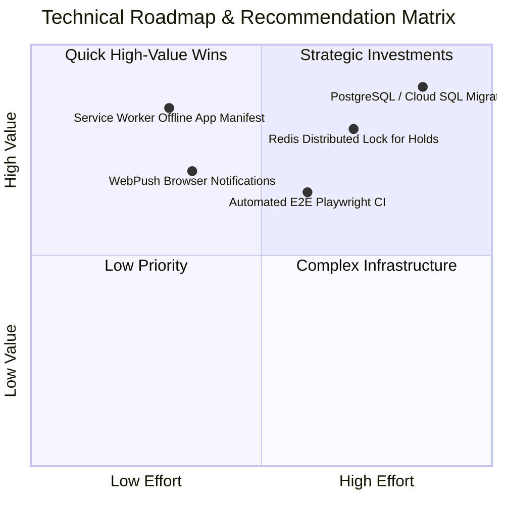

1. **Critical Priority (Production Scale)**:
   * Transition `server/db/database.ts` to **PostgreSQL with Drizzle ORM / Cloud SQL** when horizontally scaling across multiple container instances to eliminate file synchronization limits.
2. **High Priority (Sinai Connectivity UX)**:
   * Introduce a **Progressive Web App (PWA) Service Worker** with offline page caching so travelers deep inside Wadi Gnai can view confirmed vouchers with zero signal.
3. **Medium Priority (Supplier Automation)**:
   * Connect direct **WhatsApp Business API Webhooks** in addition to Twilio SMS for Egyptian Bedouin supplier confirmations.
4. **Low Priority (Refactoring)**:
   * Consolidate duplicate types between `src/types.ts` and `server/db/schema.ts` into a unified shared `/types` package.
