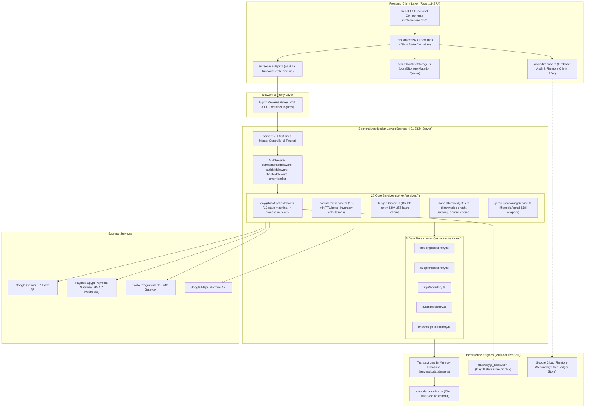

# System Current State & Discovery Audit (Phase 0 Baseline)

**Target:** `docs/CURRENT_STATE.md`  
**Auditor:** Principal Software Architect & Code Auditor  
**Date:** 2026-08-27  
**Status:** Baseline Established & Code Verified  

> ## ⚠️ SUPERSEDED — READ FIRST (2026-09-02)
>
> Dated baseline audit describing the then-persisted **Firestore**/JSON state.
> The current authoritative persistence is adapter-based with **SQLite** as the
> default (`PERSISTENCE_ADAPTER=sqlite`, store at `data/dahab.sqlite`); the
> Postgres adapter's `save()` is an empty stub and Firestore is not a production
> store. Per `AGENTS.md` the executable source is authoritative over this doc.
> Current baseline: `npm test` → 422/422, `npm run lint` clean, `npm run build` OK.

---

## 1. Executive Baseline Summary

This document represents the ground truth of the repository verified by executing compiler checks, static analysis, test runners, and deep code inspections.

### Verified Baseline Metrics:
* **TypeScript Compilation (`tsc --noEmit`):** ✅ Passed (0 type errors).
* **Production Build (`npm run build`):** ✅ Passed (Vite client assets + esbuild server bundle to `dist/server.cjs`).
* **DayGI Reliability Certification (`runReliabilityCertification.ts`):** ✅ Passed (81/81 assertions passed).
* **Knowledge OS Certification (`runKnowledgeOsCertification.ts`):** ✅ Passed (38/38 tests passed).
* **DKOS Live Product Proof (`runDkosLiveProductProof.ts`):** ⚠️ 25/30 passed (5 assertions fail due to test mock fixtures vs seed entity discrepancies).

---

## 2. Current System Architecture

---

## 3. Technology Stack & Dependency Inventory

| Category | Technology | Version | Purpose in Codebase | Source File Evidence |
| :--- | :--- | :--- | :--- | :--- |
| **Frontend Framework** | React | `^19.0.0` | UI Rendering & Concurrent Mode | `/package.json`, `/src/main.tsx` |
| **Frontend Runtime** | React DOM | `^19.0.0` | Browser DOM reconciliation | `/package.json` |
| **Build Tooling** | Vite | `^6.2.0` | Client bundling & dev server middleware | `/package.json`, `/vite.config.ts` |
| **Styling** | Tailwind CSS | `^4.0.0-alpha` | Utility stylesheet, responsive design | `/src/index.css`, `/vite.config.ts` |
| **Animation** | Motion (Framer) | `^12.4.7` | UI transitions & drawer gestures | `/package.json`, `/src/components/*` |
| **Vector Icons** | Lucide React | `^0.475.0` | Application iconography | `/package.json`, `/src/components/*` |
| **Backend Framework**| Express | `^4.21.2` | REST API routes & middleware | `/package.json`, `/server.ts` |
| **TypeScript Engine** | tsx | `^4.19.3` | Live TypeScript backend execution in dev | `/package.json` (`npm run dev`) |
| **Production Bundler**| esbuild | `^0.25.0` | Compiles server.ts to `dist/server.cjs` | `/package.json` (`npm run build`) |
| **AI LLM SDK** | `@google/genai` | `^0.1.2` | Gemini 3.7 Flash server-side integration | `/package.json`, `/server/services/geminiReasoningService.ts` |
| **Cloud DB & Auth** | Firebase SDK | `^11.4.0` | Firestore offline sync & Google OAuth | `/package.json`, `/src/lib/firebase.ts` |
| **Charts** | Recharts | `^2.15.1` | Operations & telemetry visualizations | `/package.json`, `/src/components/operations/*` |
| **Date Library** | date-fns | `^4.1.0` | Timezone offsets & trip calculations | `/package.json` |
| **Markdown** | react-markdown | `^10.0.0` | Rendering rich itineraries & guides | `/package.json` |

---

## 4. Current Data Flow & Domain Lifecycle

### 4.1 Multi-Vertical Hold & Booking Flow
1. **Hold Request (`POST /api/commerce/hold`)**:
   * Receives `skuId`, `tripId`, `travelerId`, `date`, `timeSlot`, and `idempotencyKey`.
   * Checks inventory in `db.inventorySlots`.
   * Computes available capacity: `totalCapacity - (reservedCapacity + heldCapacity)`.
   * Creates `HoldEntity` with `expiresAt = Date.now() + 15 * 60 * 1000`.
   * Increments `heldCapacity` inside a transaction block.
2. **Multi-Checkout (`POST /api/commerce/checkout/multi`)**:
   * Validates hold tokens and active expiration times.
   * Executes atomic database transaction:
     - Converts `HoldEntity` from `ACTIVE` to `CONVERTED`.
     - Decrements `heldCapacity` and increments `reservedCapacity`.
     - Creates `BookingEntity` (Status: `CONFIRMED`).
     - Appends double-entry records in `LedgerService` with `SHA-256` signature hash chaining.
     - Commits in-memory state and triggers `saveToDisk()` to `dahab_db.json`.
3. **Dispatch & Notification**:
   * Triggers `SMSGatewayService.sendBookingDispatchSMS()` (falls back to mock sandbox if credentials are not configured).

---

## 5. Current Authentication & Authorization

### 5.1 Authentication Mechanism
* **Dual Auth Scheme**:
  1. **Firebase Client Auth**: In `src/lib/firebase.ts`, Google Sign-In popups and Firebase Auth tokens are handled client-side.
  2. **Server-Side Session Bearer Tokens**: `AuthService.login()` and `AuthService.register()` issue `tok_...` tokens stored in `db.sessions` with a 72-hour TTL.
  3. **Bridge Sync (`POST /api/auth/firebase-sync`)**: When a user logs in via Firebase on the client, the client calls `/api/auth/firebase-sync` to issue a matching server Bearer token.
* **Password Hashing**: Currently uses unsalted `crypto.createHash('sha256').update(password).digest('hex')` in `server/services/authService.ts`.
* **Client Token Storage**: Stored in browser `localStorage.getItem('dahab_auth_token')`.

### 5.2 Authorization (RBAC)
* Handled server-side by `server/middleware/rbacMiddleware.ts` via `requireRole(...)`.
* Roles defined: `Traveler`, `Supplier`, `Operations`, `Product`, `Admin`.
* `Admin` role possesses wildcard privileges.

---

## 6. Current Database Engine & Storage

### 6.1 Transactional In-Memory Engine (`server/db/database.ts`)
* **In-Memory Tables (25 collections)**: Users, Sessions, Trips, TripItems, Suppliers, ProductSkus, InventorySlots, Holds, Payments, Bookings, LedgerEntries, TransferTelemetry, Notifications, AuditEvents, Opportunities, ResearchSources, TemporalFacts, EvidenceNodes, ConflictSets, AreaProfiles, Places, Activities, DiningVenues, EmergencyResources, RegulatoryDecrees, KnowledgeSnapshots.
* **ACID Transactions**:
  - `beginTransaction()`: Deep-clones state via `JSON.stringify(this.state)` to `transactionBackup`.
  - `commit()`: Flushes state asynchronously to `/data/dahab_db.json`.
  - `rollback()`: Replaces `this.state = JSON.parse(this.transactionBackup)`.
* **DayGI Task Store**: `/data/daygi_tasks.json` stores serialized tasks from `DayGiTaskOrchestrator`.

---

## 7. Current Risks & Technical Debt Inventory

1. **Database Scalability & Memory Overhead**:
   - `JSON.stringify(this.state)` inside every transaction creates high CPU overhead and memory spikes as table records increase.
   - Inability to run multiple server instances horizontally without state desynchronization.
2. **Password Security**:
   - Single-iteration unsalted `SHA-256` hashing in `AuthService` is vulnerable to rainbow table attacks.
3. **Session Token Storage in LocalStorage**:
   - Sensitive tokens stored in client `localStorage` are vulnerable to XSS attacks compared to `HttpOnly`, `Secure`, `SameSite` cookies.
4. **Tight Architectural Coupling**:
   - `server/services/daygiTaskOrchestrator.ts` directly imports type declarations from `../../src/types.ts`.
   - Massive overlap between `src/types.ts` (821 lines) and `server/db/schema.ts` (511 lines).
5. **Frontend State Monolith**:
   - `src/context/TripContext.tsx` contains 1,338 lines handling routing, auth, booking, food, cart, offline synchronization, opportunities, and modal states.
6. **In-Process Concurrency Locks**:
   - `executingLocks: Set<string>` in `DayGiTaskOrchestrator` and in-memory hold timers in `CommerceService` are bound to a single Node.js process.
7. **Test Assertions Discrepancy**:
   - `server/test/runDkosLiveProductProof.ts` contains 5 failing tests due to mismatched mock expectations against the initial seed data.

---

## 8. Current Deployment & Infrastructure

* **Container Model**: Cloud Run Container Sandbox, Port 3000 hardcoded ingress.
* **Development Command**: `npm run dev` -> `tsx server.ts` (Express hosting Vite in middleware mode).
* **Production Build**: `npm run build` -> `vite build && esbuild server.ts --bundle --platform=node --format=cjs --packages=external --sourcemap --outfile=dist/server.cjs`.
* **Production Start**: `node dist/server.cjs`.
