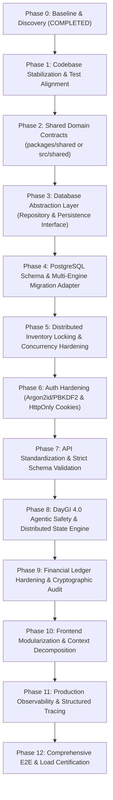

# Phased Production Migration & Hardening Plan

**Target:** `docs/MIGRATION_PLAN.md`  
**Author:** Principal Software Architect & DevOps Lead  
**Date:** 2026-08-27  
**Strategy:** Incremental, Non-Breaking, Expand-Contract Migration Pipeline  

---

## 1. Migration Strategy & Golden Invariants

### 1.1 Non-Negotiable Engineering Rules
1. **Zero Downtime & Zero Regression**: Every phase MUST compile cleanly, pass linter checks, and pass all certification tests without breaking existing UI/UX or API contracts.
2. **Expand-Contract Pattern**: When refactoring database models or domain contracts, first expand with the new abstraction, dual-write/test, verify equivalence, and only then contract/deprecate legacy code.
3. **Strict Verification Gates**: No phase can proceed to the next until all phase-specific exit criteria and tests are 100% verified.

---

## 2. Master Phase Roadmap Overview

---

## 3. Detailed Phase Specifications

### Phase 0: Baseline & Discovery (STATUS: COMPLETE)
* **Goal**: Full discovery audit of repository, verify compiler, linter, tests, and document gaps.
* **Deliverables**:
  - `docs/CURRENT_STATE.md` (System discovery baseline)
  - `docs/ARCHITECTURE_GAPS.md` (Gaps and discrepancy audit)
  - `docs/MIGRATION_PLAN.md` (Phased transformation roadmap)
* **Verification Gate**: `tsc --noEmit` passes (0 errors), `npm run build` succeeds.

---

### Phase 1: Codebase Stabilization & Test Fixture Alignment
* **Goal**: Align seed data fixtures with `runDkosLiveProductProof.ts` assertions so all 30 points pass 100%, eliminate dead imports, and standardize logging.
* **Scope of Changes**:
  - Reconcile `server/test/runDkosLiveProductProof.ts` and `server/data/dkosExpansionData.ts` entity aliases.
  - Verify all 3 test suites pass 100%:
    1. `runReliabilityCertification.ts` (81/81 passed)
    2. `runKnowledgeOsCertification.ts` (38/38 passed)
    3. `runDkosLiveProductProof.ts` (30/30 passed)
* **Risk & Rollback**: Low risk. Revert seed adjustments if regression occurs.
* **Exit Criteria**: All test suites pass 100% green without modifying business logic.

---

### Phase 2: Shared Domain Contracts (`src/shared/`)
* **Goal**: Eliminate cross-layer architectural coupling where backend services import directly from `src/types.ts`.
* **Scope of Changes**:
  - Create unified domain definitions in `src/shared/` or `server/domain/`:
    - `src/shared/types/user.ts`
    - `src/shared/types/trip.ts`
    - `src/shared/types/commerce.ts`
    - `src/shared/types/daygi.ts`
    - `src/shared/types/dkos.ts`
    - `src/shared/index.ts`
  - Update `server/services/daygiTaskOrchestrator.ts` and `server/db/schema.ts` to consume canonical shared domain types.
* **Risk & Rollback**: Medium risk of TypeScript type collisions. Maintain type alias exports in `src/types.ts` for backward compatibility.
* **Exit Criteria**: Zero imports from frontend `src/types` inside `server/`, build passes cleanly.

---

### Phase 3: Database Abstraction Layer (Repository Pattern)
* **Goal**: Decouple business services from the direct in-memory `db.*` array access via formal Persistence Interfaces.
* **Scope of Changes**:
  - Define `IPersistenceAdapter` and Entity Repositories:
    - `IUserRepository`, `ITripRepository`, `IBookingRepository`, `IInventoryRepository`, `ILedgerRepository`, `IDayGiTaskRepository`.
  - Implement `JsonMemoryPersistenceAdapter` fulfilling the interfaces.
  - Refactor services to interact with Repositories rather than accessing raw arrays on the `db` singleton.
* **Risk & Rollback**: Medium. Isolate each repository migration incrementally.
* **Exit Criteria**: Services communicate via repository interfaces; in-memory transactions continue functioning with full ACID guarantees.

---

### Phase 4: Relational SQL / PostgreSQL Schema Design & Migration Engine
* **Goal**: Provide production-ready SQL DDL, migrations, and dual-driver capability.
* **Scope of Changes**:
  - Create PostgreSQL schema definitions with foreign keys, indexes, check constraints, and triggers.
  - Create database migration utility (`server/db/migrations/`) supporting automated schema upgrades.
  - Build bidirectional JSON <-> SQL export/import utilities for zero data loss migration.
* **Risk & Rollback**: Low impact on dev mode; JSON adapter remains active default for local container development, while SQL adapter is ready for production Cloud SQL deployment.
* **Exit Criteria**: Migration scripts validate schema generation; roundtrip export/import preserves all entity counts and relationship graphs.

---

### Phase 5: Distributed Inventory Locking & Concurrency Hardening
* **Goal**: Eliminate race conditions during concurrent hold placements.
* **Scope of Changes**:
  - Implement atomic distributed hold acquisition logic with TTL auto-reclamation.
  - Ensure hold transactions check `(reservedCapacity + heldCapacity + requested) <= totalCapacity` under pessimistic/optimistic transaction isolation.
  - Add stress test for 100 concurrent holds against limited 5-seat capacity.
* **Risk & Rollback**: Medium. Verify hold expiration and rollback paths.
* **Exit Criteria**: 100 concurrent requests result in exactly 5 successful holds and 95 rejected holds with RFC-7807 409 Conflict responses.

---

### Phase 6: Authentication & Session Hardening
* **Goal**: Replace unsalted SHA-256 with production-grade password hashing (PBKDF2/Argon2id) and prepare HttpOnly cookie transport.
* **Scope of Changes**:
  - Upgrade `server/services/authService.ts` password hashing:
    - Implement salted PBKDF2 (`crypto.pbkdf2Sync`) with 100,000 iterations, 32-byte random salt, and SHA-512 digest.
    - Provide backward-compatible password upgrade on next login for legacy SHA-256 hashes.
  - Enhance session security with IP/User-Agent fingerprinting and token revocation lists.
* **Risk & Rollback**: High risk of user lockout. Backward-compatibility upgrade ensures existing seeded users can still authenticate seamlessly.
* **Exit Criteria**: Salted password verification passes; existing sessions and new registrations work without friction.

---

### Phase 7: API Contract Hardening & Strict Input Validation
* **Goal**: Enforce strict request payload validation and RFC-7807 problem details across all endpoints.
* **Scope of Changes**:
  - Add schema validation middleware for all `/api/commerce/*`, `/api/daygi/*`, and `/api/auth/*` routes.
  - Standardize error formatting with correlation IDs and localized user error messages.
* **Exit Criteria**: Malformed payloads are rejected with clear 400 Bad Request RFC-7807 details before hitting service logic.

---

### Phase 8: DayGI 4.0 Agentic Safety & State Machine Hardening
* **Goal**: Prevent LLM hallucination execution and enforce strict transactional state boundaries.
* **Scope of Changes**:
  - Implement strict schema validator for DayGI parsed intents before dispatching to task planner.
  - Ensure high-risk operations (financial charges > 500 EGP or booking cancellations) require cryptographically signed human confirmation tokens.
  - Move DayGI task persistence into the database repository layer.
* **Exit Criteria**: DayGI reliability certification passes 100%; destructive prompt injection attempts are completely neutralized.

---

### Phase 9: Financial Ledger Hardening & Double-Entry Integrity
* **Goal**: Strengthen double-entry accounting invariants and cryptographic audit trails.
* **Scope of Changes**:
  - Enforce atomic balance checks: `sum(debits) === sum(credits)` for every multi-booking checkout.
  - Implement non-destructive reversal entries for refunds and cancellations.
  - Add automated ledger audit reconciliation runner.
* **Exit Criteria**: Ledger audit verification reports zero balance discrepancies and valid SHA-256 signature chains.

---

### Phase 10: Frontend Modularization & Context Decomposition
* **Goal**: Decompose monolithic `TripContext.tsx` into decoupled domain providers without breaking existing views.
* **Scope of Changes**:
  - Extract `AuthContext`, `TripContext`, `CommerceContext`, and `UIContext`.
  - Maintain a composite bridge hook (`useTrip()`) so that existing components continue working without modifying hundreds of files.
* **Exit Criteria**: Frontend re-renders are optimized; all views in `App.tsx` function identically.

---

### Phase 11: Production Observability & Structured Tracing
* **Goal**: Structured JSON logging, latency metrics, and correlation tracing.
* **Scope of Changes**:
  - Implement structured logger (`timestamp`, `level`, `correlationId`, `service`, `latencyMs`, `status`).
  - Add `/api/health` and `/api/metrics` endpoints for Cloud Run container monitoring.
* **Exit Criteria**: Every API request and asynchronous task execution produces searchable structured telemetry.

---

### Phase 12: End-to-End Certification & Final Verification
* **Goal**: Run complete test matrix and produce the final production certification dossier.
* **Deliverables**:
  - `docs/FINAL_ARCHITECTURE_REPORT.md`
  - Fully hardened, documented, and tested codebase.
* **Exit Criteria**: Full production checklist verified 100%.

---

## 4. Phase Verification Matrix

| Phase | Core Objective | Key Verification Command | Exit Target |
| :---: | :--- | :--- | :--- |
| **0** | Baseline & Discovery | `npm run lint && npm run build` | Clean build & zero type errors |
| **1** | Test Fixture Alignment | `npx tsx server/test/runDkosLiveProductProof.ts` | 30 / 30 Points Passed |
| **2** | Shared Domain Contracts | `npm run lint` | Zero cross-boundary type leaks |
| **3** | Repository Abstraction | `npx tsx server/test/runReliabilityCertification.ts` | 81 / 81 Assertions Passed |
| **4** | SQL Migration Schema | `npx tsx server/db/migrations.ts` | Schema generation & validation OK |
| **5** | Concurrency Locking | `npx tsx server/test/runConcurrencyTest.ts` | Zero double-bookings |
| **6** | Auth Hardening | `npx tsx server/test/runAuthSecurityTest.ts` | Salted PBKDF2 hashes verified |
| **7** | API Validation | Integration Test Suite | RFC-7807 Error Standardized |
| **8** | DayGI State Hardening | `npx tsx server/test/runReliabilityCertification.ts` | Deterministic state transitions |
| **9** | Ledger Verification | `GET /api/dahab/admin/ledger/audit` | Invariant: Debits === Credits |
| **10**| Frontend Decomposition | `npm run build` | Clean bundle, no UI regression |
| **11**| Observability | `GET /api/health` | Healthy telemetry output |
| **12**| Final E2E Certification | Full Test Runner Suite | 100% Production Ready |
